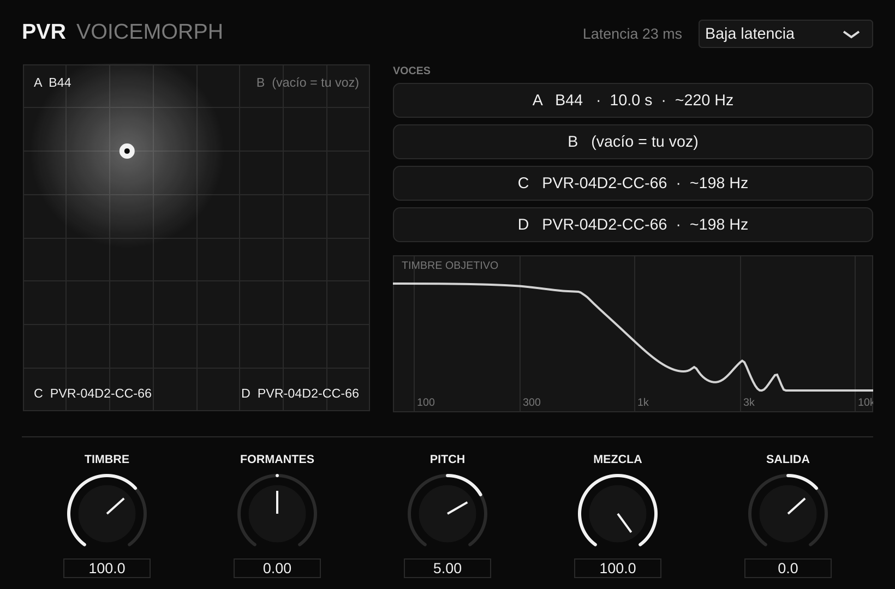

# PVR VoiceMorph



Plugin VST3 (y app standalone) para Windows que transforma el **timbre** de una voz hacia una o varias voces objetivo, en tiempo real. Está inspirado en el flujo de trabajo de Vocoflex: cargás una muestra corta de una voz, el plugin la analiza y tu voz (o la pista) adopta su color, sin perder la pronunciación ni la entonación.

## Qué hace (y qué no)

| | Vocoflex | PVR VoiceMorph |
|---|---|---|
| Voz objetivo a partir de ~10 s de audio | ✔ (IA) | ✔ (análisis espectral) |
| Mantiene pronunciación y entonación | ✔ | ✔ |
| Mezclar/morphear varias voces | ✔ (luz/sombra) | ✔ (pad X/Y con 4 voces) |
| Pitch y formantes | ✔ | ✔ (±12 st, con preservación de formantes) |
| Generar voces y compartirlas por código | ✔ (color) | ✔ (códigos `PVR-XXXX-XX-XX`) |
| Tiempo real, solo CPU | ✔ 35 / 105 ms | ✔ 23 / 43 ms, ~2 % de CPU |
| Automatización desde el DAW | ✔ | ✔ (todos los parámetros, incluido el pad) |
| Clonado "convincente" de identidad vocal | ✔ (red neuronal) | ✘ |

La diferencia de fondo: Vocoflex usa un modelo de IA entrenado. VoiceMorph usa DSP clásico: extrae la envolvente espectral (formantes y color) de la voz objetivo y le aplica a tu voz un filtro que corrige su timbre promedio hacia el de la voz objetivo. El resultado se parece más a "tu voz con el color de otra" que a un clon. Para producción, efectos vocales, cambios de carácter y diseño de sonido funciona muy bien. Para que suene literalmente como otra persona hace falta IA (ver *Próximos pasos*).

## Cómo funciona por dentro

Por cada frame STFT (ventana Hann, 75 % de solapamiento):

1. **Envolvente espectral** con cepstrum iterativo ("true envelope"): son los formantes, el color de la voz.
2. **Excitación** = espectro − envolvente: acá están el pitch y la articulación.
3. **Pitch shift** sobre la excitación, con phase vocoder y *phase locking*. Los formantes no se mueven, así que no queda el efecto "ardilla".
4. **Transferencia de timbre**: el plugin mantiene un promedio largo (~1,5 s) de la envolvente de tu voz y aplica el filtro `voz objetivo − tu promedio`. Como el promedio no cambia de vocal a vocal, se conserva la pronunciación.
5. **Formant shift**: estira o comprime la envolvente corregida.

## Compilar para Windows

### Descarga directa

La última versión compilada está en **[Releases](https://github.com/leopvr/pvr-voicemorp/releases/latest)**. Para publicar una versión nueva, cambiá el número en `project(PVRVoiceMorph VERSION 1.0.0)` dentro de `CMakeLists.txt` y subí el cambio a `main`: el Release se genera solo.

### Opción A: sin instalar nada (GitHub Actions)

1. Cada `push` a este repo dispara la compilación.
2. En la pestaña **Actions** se ejecuta solo el workflow "Compilar para Windows" (tarda ~10 minutos).
3. Al terminar, bajá el artefacto **PVR-VoiceMorph-Windows**. Adentro están los zips del `.vst3` y del `.exe` standalone.

### Opción B: en tu PC

1. Instalá **Visual Studio 2022 Community** con la carga de trabajo *"Desarrollo para el escritorio con C++"* (ya incluye CMake).
2. Abrí *"Developer PowerShell for VS 2022"* en la carpeta del proyecto y corré:
   ```
   cmake -B build -A x64
   cmake --build build --config Release --target PVRVoiceMorph_VST3 PVRVoiceMorph_Standalone
   ```
   La primera vez CMake baja JUCE desde GitHub de forma automática.
3. El plugin queda en `build\PVRVoiceMorph_artefacts\Release\VST3\PVR VoiceMorph.vst3`.

### Instalar en Ableton

1. Copiá la carpeta `PVR VoiceMorph.vst3` a `C:\Program Files\Common Files\VST3\`.
2. En Ableton: *Preferencias → Plug-Ins → activar "Use VST3 Plug-In System Folders"* y hacé clic en *Rescan*.
3. Aparece en *Plug-Ins → PVR → PVR VoiceMorph*. Ponelo en una pista de voz o en una pista de audio con el micrófono.

## Cómo se usa

1. **Cargá una voz**: clic en el slot **A** → *Cargar muestra de voz*. Funcionan mejor 10 a 30 segundos de voz **seca**: sin reverb, sin música de fondo, sin distorsión. Con una sola persona y, si es posible, cantando.
2. **Pad X/Y**: cada esquina es un slot (A arriba a la izquierda, B arriba a la derecha, C abajo a la izquierda, D abajo a la derecha). El cursor ("la luz") mezcla las voces según su cercanía a cada esquina. **Un slot vacío equivale a tu propia voz**: si acercás el cursor a una esquina vacía, el efecto baja.
3. **Knobs**:
   - **Timbre** (0–150 %): cuánto color de la voz objetivo se aplica. Pasado el 100 % se exagera.
   - **Formantes** (±12 st): más grave/grande o más agudo/chico, sin cambiar las notas.
   - **Pitch** (±12 st): cambia las notas y conserva los formantes.
   - **Mezcla**: dry/wet (la señal seca se retrasa la misma latencia, así que no hay problemas de fase).
   - **Salida**: ganancia.
4. **Modo**: *Calidad alta* (43 ms, mejor pitch shift) para pistas grabadas; *Baja latencia* (23 ms) para cantar en vivo. Ableton compensa la latencia de forma automática.
5. **Voces generadas**: en el menú del slot → *Generar voz aleatoria* (grave, media o aguda). Cada voz generada tiene un código, por ejemplo `PVR-04D2-CC-66`, que podés copiar y pasarle a otra persona para que la recree con *Pegar código de voz*.
6. **Guardar voces**: *Guardar esta voz (.pvrvoice)* para armar tu propia librería. Además, las voces cargadas se guardan dentro del proyecto de Ableton, así que no dependés del archivo original.

Tip: automatizá el pad X/Y en Ableton para que la voz se transforme a lo largo de un tema. También le podés mapear un controlador MIDI con *Map*.

## Estructura

```
src/dsp/            Motor de audio sin dependencias (C++17)
  SimpleFFT.h       FFT radix-2
  VoiceEngine.*     STFT, envolvente, pitch/formant shift, transferencia de timbre
  VoiceProfile.*    análisis de muestras, generador de voces, códigos
src/PluginProcessor.*  parámetros, 4 slots, estado del proyecto
src/PluginEditor.*     interfaz (pad X/Y, visor de timbre, knobs)
tests/              pruebas del motor y del plugin
```

Pruebas del motor (en CI corren de forma automática): `cmake --build build --config Release --target engine_tests`.

## Licencia de JUCE

JUCE 8 tiene licencia dual: AGPLv3 o licencia comercial. Para uso personal o para regalarlo con el código abierto no hay problema. **Si vas a vender el plugin con el código cerrado**, revisá las condiciones de licencia en juce.com antes de publicarlo.

## Próximos pasos posibles

- **Modo IA**: enchufar un modelo de conversión de voz (RVC/so-vits exportado a ONNX) en `VoiceEngine` para lograr clonado real. La arquitectura de slots, el pad y el estado ya sirven tal cual.
- Modo "sombra": restar características de una voz (por ejemplo, el aire) en lugar de sumarlas.
- Presets de fábrica a partir de voces propias o de colaboradores (siempre con su permiso).
